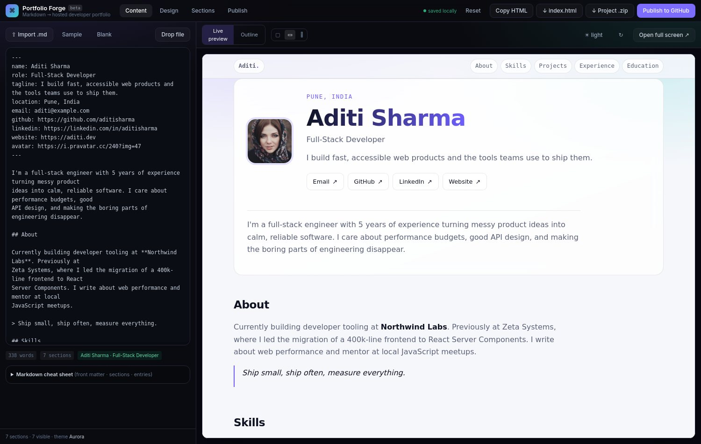

# Portfolio Forge

**Markdown in → hosted developer portfolio out.**

A browser app: paste a `.md` résumé, pick a theme, tweak it live, then publish it to GitHub Pages in one click. Everything — the Markdown parser, the theme renderer, the zip export and the whole GitHub publish flow — runs client-side, so the app itself is a static site you can host on GitHub Pages next to the portfolios it generates.

The generated site is a **single self-contained `index.html`**: no build step, no CDN, no external requests (fonts included), prints to PDF cleanly.

```
Next.js 14 (static export) · Tailwind CSS · remark / unified · GitHub REST API v3
```



Six themes, light + dark, one Markdown file:


Aurora · Terminal · Editorial · Minimal · Neon Grid · Sunset Card — full-size previews in `docs/themes/`.

---

## Quick start

```bash
npm install
npm run dev        # http://localhost:3000 — dev server with hot reload
```

Production / static build:

```bash
npm run build      # static site → ./out   (no Node runtime needed)
npm run serve      # serve ./out on http://localhost:3000
```

Node 18+. Zero environment variables, zero backend, no database.

`npm run check` runs the parser/renderer/export test suite offline (23 assertions).

---

## Hosting the app itself on GitHub Pages

The app is a static site, so it can live in the very same repo as the source.

**One-time setup**

1. Push this repo to GitHub.
2. **Settings → Pages → Source: GitHub Actions.**
3. Every push to `main` runs `.github/workflows/deploy-app.yml`, which builds the export and publishes `./out`.

Your studio is then live at `https://<user>.github.io/<repo>/` — put that link in the repo's *About → Website* field (or the badge below) so visitors land on the working app.

The workflow derives the correct Next.js `basePath` from the repository name (`<user>.github.io` → root, anything else → `/<repo>/`), so there is nothing to configure.

**Prefer “Deploy from a branch → main → /docs”?**

```bash
npm run build:docs      # git origin is read, out/ is built with the right basePath, copied to docs/app
git add docs/app && git commit -m "chore: build app for Pages" && git push
```

Then set **Settings → Pages → Source: Deploy from a branch → main → /docs**; the app is served from `…/<repo>/app/`.

**Building by hand**

```bash
BASE_PATH=/<repo> npm run build     # sub-path repo
BASE_PATH= npm run build            # user site or custom domain
npm run serve                       # local check of the export
# ./out can go to GitHub Pages, Netlify, Vercel, Cloudflare Pages, S3 — anything static
```

> Live app: `https://<user>.github.io/<repo>/` — replace after your first deploy.

---

## What it does

| Feature | Where |
| --- | --- |
| Import `.md` (picker or drag & drop), edit in a monospace editor with Tab-to-indent | **Content** tab |
| Front-matter profile: name, role, tagline, location, email, GitHub, LinkedIn, site, avatar, résumé | **Content** → cheat sheet |
| Live preview, three viewports, light/dark, full-screen, outline mode | right pane |
| 6 themes × light/dark, accent override, fonts, corners, density, width, element toggles | **Design** tab |
| Section detection from `##` headings; rename / reorder / hide; hero overrides | **Sections** tab + Outline |
| Publish to GitHub (create repo → commit files → enable Pages) | **Publish** tab |
| Export one `index.html` or a full project `.zip` | toolbar |

### Smart section layouts

Each `##` heading is classified and gets a purpose-built layout:

- `## Skills` → chip cloud (also handles `**Languages:** TS, Rust` groups)
- `## Projects` / `## Education` → card grid; `- Tech: …` becomes tech chips, `[links](…)` become buttons
- `## Experience` / `## Work History` → timeline with date & company detection
- `## About` / `## Summary` → prose (text above the first heading is promoted into the hero)
- `## Contact` → prose + hero contact buttons
- anything else → prose, with full GFM (tables, task lists, code fences, footnotes)

Markdown runs through `remark-parse → remark-gfm → remark-rehype → rehype-stringify`; front matter is a small dependency-free reader. Themes are CSS variables plus a short "skin" block, so the whole page ships in one `<style>` tag.

---

## Publishing a portfolio

1. Create a token: [classic with `repo` scope](https://github.com/settings/tokens/new?scopes=repo), or fine-grained with **Contents: Read & write** (+ **Administration: Read & write** if you want the app to create the repo for you).
2. **Publish** tab → paste → **Test token** → pick a repo name (`<you>.github.io` for a root site, anything else for `https://<you>.github.io/<repo>/`).
3. **Deploy to GitHub Pages**.

The flow (`lib/github.js`, entirely in your browser):

1. `GET /user` — verify the token, get the owner login
2. `GET /repos/:owner/:repo` — create it if missing
3. read the branch head (works on empty repos)
4. upload blobs → build a tree → commit → create/update `refs/heads/main` (fast-forward, never forced)
5. enable Pages (`POST /repos/:owner/:repo/pages`, `PUT` when it already exists)

Every step streams into a checklist in the UI. Re-publishing adds one commit.

**Pushed files**

```
index.html                      # the whole site, self-contained
portfolio.md                    # your source markdown
README.md  .gitignore  .nojekyll
.github/workflows/deploy.yml    # optional Actions-based Pages deploy
```

The token goes straight from your browser to `api.github.com` — there is no server in this app that could see it. Keep it in a throwaway tab, and revoke it when done.

---

## Project layout

```
app/
  page.js                 studio shell
  preview/page.js          full-screen preview of the compiled document
  icon.svg  layout.js  globals.css
components/Studio.js      editor, theming, section controls, publish UI
lib/
  markdown.js             front matter, section splitting, classification, HTML
  markdown-client.js      browser markdown pipeline
  render.js               page + theme CSS generation (the "compiler")
  themes.js               6 themes (light/dark palettes + skins) + font map
  fonts.js                self-hosted woff2 loading for the studio
  github.js               browser-side GitHub publish flow
  publish-files.js        repo scaffolding (README, workflow, .nojekyll)
  options.js  sample.js   defaults + demo résumé
public/fonts/*.woff2      Inter, Newsreader, JetBrains Mono (inlined on export)
scripts/check-export.mjs  offline parser/render/export tests  → npm run check
scripts/build-docs-app.mjs builds ./out into docs/app for branch-based Pages
scripts/smoke-test.sh     checks ./out and optionally a served instance
.github/workflows/deploy-app.yml   builds ./out → GitHub Pages
examples/sample-resume.md          demo input
```

## Adding a theme

```js
{
  id: 'mytheme', name: 'My Theme', vibe: 'one-line description',
  display: FONTS.sans, body: FONTS.sans, mono: FONTS.mono, radius: '12px',
  light: { bg, surface, surfaceSolid, text, muted, border, accent, accent2, shadow, glow },
  dark:  { ...same keys... },
  skin: `.card{border-radius:0} .section-title{text-transform:uppercase}`, // optional
}
```

It shows up in the Design tab in both modes, and in exports and published sites.

## Testing

```bash
npm run check                       # 23 offline assertions: parse → render → export
npm run build && npm run serve
./scripts/smoke-test.sh http://localhost:3000   # static export + served instance
```

Manual UI and real-publish checklists: [TESTING.md](TESTING.md).

## Notes & limits

- Markdown is rendered with `allowDangerousHtml`, so raw HTML in your markdown is honoured — great for a personal site, but only publish your own content.
- Avatars are URLs (GitHub raw, Gravatar, an image in the repo). No upload pipeline.
- GitHub Pages needs a public repo on free plans; private repos need a paid plan (the app pushes the files and tells you).
- Drafts, theme choices and section edits live in `localStorage`; **Reset** clears them.
- Bundle: ~158 kB first load for the studio, 1.1 MB for the whole static export.

## License

MIT — see [LICENSE](LICENSE). Use it, fork it, ship your own portfolio with it.
