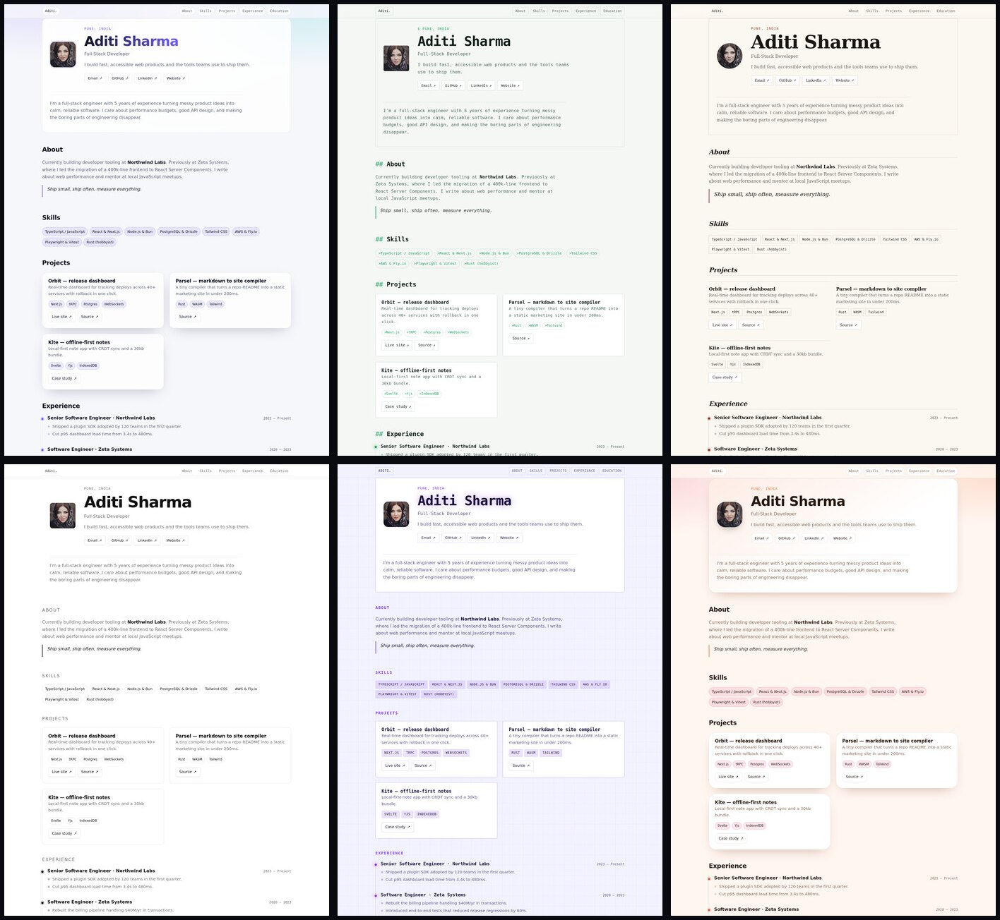

# Portfolio Forge

**Markdown in → hosted developer portfolio out.**

Paste a `.md` résumé, pick one of six themes, tune it live, then publish it to GitHub Pages in one click. The generated site is a **single self-contained `index.html`** — no build step, no dependencies, no CDN, works offline and prints cleanly to PDF.

```
Next.js 14 (App Router) · Tailwind CSS · remark / unified · GitHub REST API v3
```


Six themes, light + dark, one Markdown file:



Aurora · Terminal · Editorial · Minimal · Neon Grid · Sunset Card — full-size previews in `docs/themes/`.

---

## Quick start

```bash
npm install
npm run dev        # http://localhost:3000
npm run build && npm start   # production
```

Node 18+. No environment variables are required — publishing uses a GitHub token you paste in the UI (it is used for one server-side request and never stored).

---

## What it does

| Feature | Where |
| --- | --- |
| Import `.md` (file picker or drag & drop), edit in a monospace editor with Tab-to-indent | **Content** tab |
| Front-matter profile (name, role, tagline, location, email, GitHub, LinkedIn, site, avatar, résumé) | **Content** → cheat sheet |
| Live preview, 3 viewport widths, light/dark, full-screen, outline mode | right pane |
| 6 themes × light/dark, accent override, fonts, corner radius, density, page width, element toggles | **Design** tab |
| Section detection from `##` headings, rename / reorder / hide, hero overrides | **Sections** tab + Outline |
| Publish to GitHub (create repo → commit files → enable Pages) | **Publish** tab |
| Export a single `index.html` or a full project `.zip` | toolbar |

### Smart section layouts

The compiler classifies each `##` heading and gives it a purpose-built layout:

- `## Skills` → chip cloud (supports `**Language:** TS, Rust` grouped form)
- `## Projects` / `## Education` → card grid; `- Tech: …` lines become tech chips, `[links](…)` become buttons
- `## Experience` / `## Work History` → vertical timeline with date/company detection
- `## About` / `## Summary` → prose (the pre-heading intro is promoted into the hero)
- `## Contact` → prose + hero contact buttons
- anything else → prose, with full GFM (tables, task lists, code fences, footnotes)

Markdown parsing is `remark-parse → remark-gfm → remark-rehype → rehype-stringify` (`lib/markdown.js`, and the same pipeline runs client-side in `lib/markdown-client.js`). Front matter is a tiny dependency-free `key: value` reader, so the browser bundle stays small.

---

## Publishing

1. Create a token: [classic with `repo` scope](https://github.com/settings/tokens/new?scopes=repo) or a fine-grained token with **Contents: Read & write** (+ **Administration: write** if you want the app to create the repo for you).
2. **Publish** tab → paste token → choose a repo name (`<you>.github.io` for a root site, anything else for `https://<you>.github.io/<repo>/`).
3. Hit **Deploy to GitHub Pages**.

`app/api/deploy/route.js` performs, in order:

1. `GET /user` → verifies the token and gets the owner login
2. `GET /repos/:owner/:repo` → creates it with `POST /user/repos` if missing
3. Reads the branch head (works on empty repos too)
4. Uploads blobs, builds a tree, commits, creates/updates `refs/heads/main` — a fast-forward commit, never a force push
5. Enables Pages (`POST /repos/:owner/:repo/pages`, `PUT` if it already exists)

Each step is streamed back to the UI as a checklist. Re-publishing is idempotent: same repo, one new commit.

**What gets pushed**

```
index.html                        # the whole site, self-contained
portfolio.md                      # your source markdown
README.md  .gitignore  .nojekyll
.github/workflows/deploy.yml      # optional Actions-based Pages deploy
```

### Hardening before shipping this publicly

- Put publishing behind auth (the route currently accepts a token per request, so anyone who can reach the app can create repos in *their own* account — add a session check if the app is internet-facing).
- Consider reading a server-side `GITHUB_TOKEN` and using a fine-grained token scoped to a single repo instead of accepting one in the body.
- Rate limits: GitHub allows 5,000 authenticated requests/hour; the deploy flow uses ~8.

---

## Project layout

```
app/
  page.js                 studio shell (server component seed)
  preview/page.js         full-screen preview (renders the compiled doc in an iframe)
  api/compile/route.js    markdown → { profile, sections[] }
  api/render/route.js     markdown + options → complete HTML document
  api/export/route.js     markdown + options → file map (site + repo scaffolding)
  api/deploy/route.js     GitHub publish flow
components/Studio.js      editor, theming, section controls, publish UI
lib/
  markdown.js             front matter, section splitting, classification, HTML
  render.js               page + theme CSS generation (the "compiler")
  themes.js               6 theme definitions (light/dark palettes + skins)
  publish-files.js        repo scaffolding (README, workflow, .nojekyll)
  sample.js               the demo résumé
```

Everything the published site needs is generated into one `<style>` block and inline markup — themes are CSS variables plus a small "skin" override, so adding a theme is ~30 lines in `lib/themes.js`.

## Adding a theme

```js
{
  id: 'mytheme', name: 'My Theme', vibe: 'one-line description',
  display: FONTS.sans, body: FONTS.sans, mono: FONTS.mono, radius: '12px',
  light: { bg, surface, surfaceSolid, text, muted, border, accent, accent2, shadow, glow },
  dark:  { ...same keys... },
  skin: `.card{border-radius:0} .section-title{text-transform:uppercase}`, // optional
}
```

It appears in the Design tab automatically, in both modes, and in the export.

## Notes & limits

- Markdown is rendered with `allowDangerousHtml`, so raw HTML in your markdown is honoured — that's a feature for a personal site, but it means you should only publish your *own* content.
- Avatars are plain URLs (GitHub raw, Gravatar, an image in the repo). No upload pipeline.
- GitHub Pages needs a public repo on free plans; private repos require a paid plan (the app pushes the files and tells you).
- The editor keeps your draft in `localStorage`; "Reset" clears it.

---

## License

MIT — see [LICENSE](LICENSE). Use it, fork it, ship your own portfolio with it.
